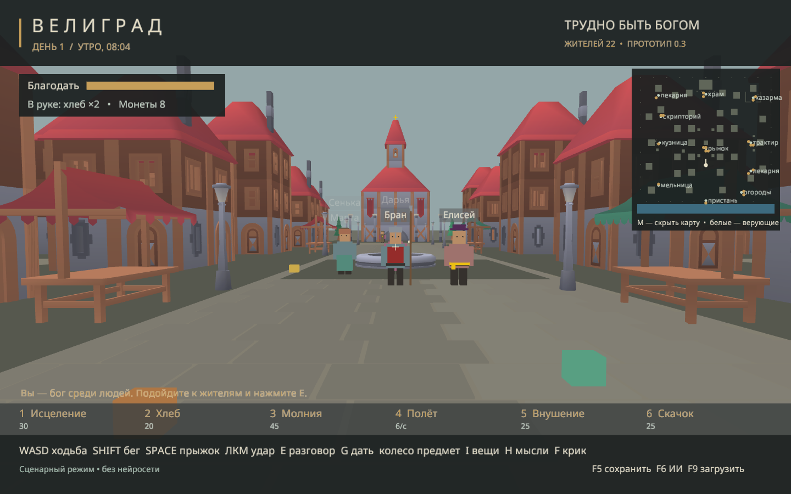
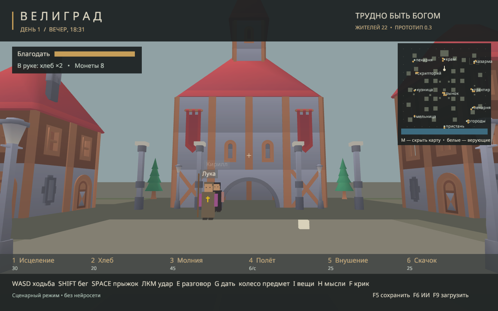
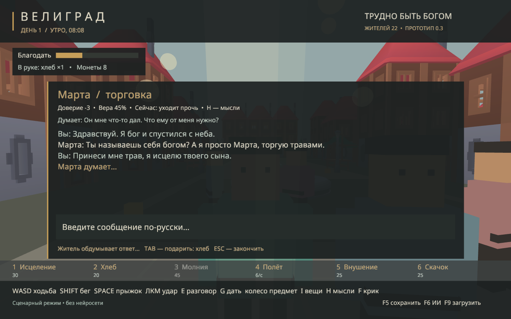
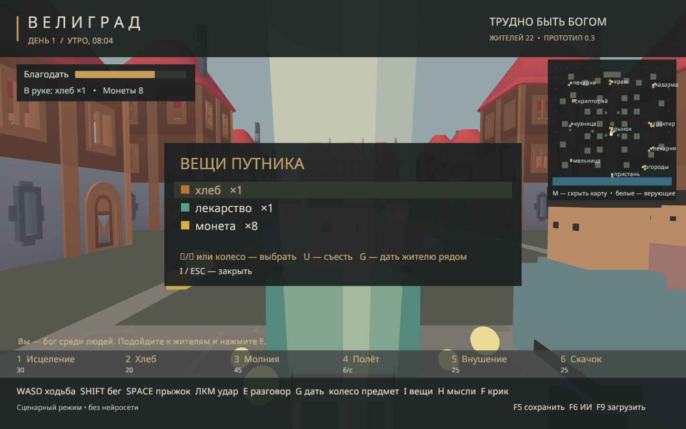
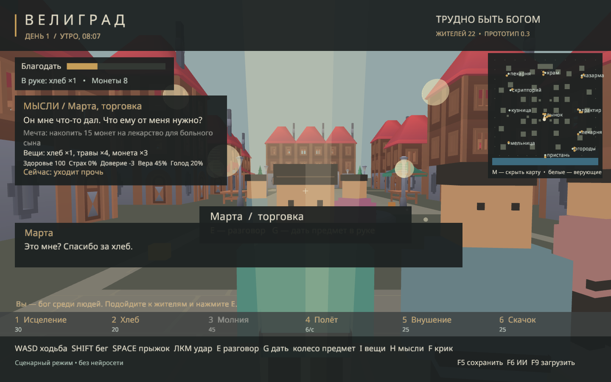

<div align="center">

# Велиград · Hard to Be God

**Социальная песочница о власти, вере и последствиях вмешательства.**

Вы — бессмертный путник среди жителей средневекового города. Они работают,
голодают, дружат и враждуют. Чудо может убедить их в вашей божественности.
Заставит ли оно вам доверять?

[](https://github.com/villetacore/hard-to-be-god/actions/workflows/ci.yml)
[](LICENSE)
[](Cargo.toml)

[Начать играть](#быстрый-старт) · [Управление и механики](docs/GAMEPLAY.md) · [План развития](docs/ROADMAP.md) · [Участие](CONTRIBUTING.md)



</div>

## Что это за игра

Экспериментальная симуляция от первого лица на **Rust + Macroquad**.
В городе живут **22 персонажа**, есть **26 домов и 11 общественных мест**.
У жителей собственные мечты, вещи, память, отношения и распорядок дня.

- **Живое хозяйство.** Мельник делает муку, пекарь печёт хлеб, лекарь использует травы.
- **Общение и поручения.** Жителей можно попросить принести вещь, пойти за вами или обратиться к соседу.
- **Шесть чудес.** Исцеление, хлеб, молния, полёт, внушение и скачок меняют поведение очевидцев.
- **Локальный ИИ.** LM Studio предлагает решения персонажей; движок исполняет действия в мире.
- **Игра без модели.** Сценарный режим поддерживает распорядок, работу и базовую жизнь города.

Это **прототип**, а не законченная игра. Интерьеров и озвучки пока нет.
Сохранения ещё не восстанавливают полный мир; асинхронные решения и длинные
поручения требуют дальнейшей работы. [Подробное состояние](docs/CURRENT_STATE.md).

## Скриншоты

| Район храма | Разговор с жителем |
| :---: | :---: |
|  |  |
| Инвентарь | Божественное вмешательство |
|  |  |

Кадры существующего прототипа из репозитория; они не подтверждают проверку новой сборки.

## Быстрый старт

Нужен актуальный стабильный **Rust с поддержкой edition 2024** и системный компилятор.
На Windows установите средства сборки Visual Studio с C++; на macOS — Xcode Command Line Tools.
Для Linux нужны системные библиотеки X11/OpenGL/ALSA; список для Ubuntu находится в [CI](.github/workflows/ci.yml).
Основная прежняя среда прототипа — Windows; совместимость macOS/Linux проверяется отдельно.

```sh
git clone https://github.com/villetacore/hard-to-be-god.git
cd hard-to-be-god
cargo run --locked -- --offline
```

`--offline` **после `--`** отключает модель в игре. Для автономной сборки Cargo
сначала загрузите зависимости командой `cargo fetch --locked`, затем используйте
`cargo run --locked --offline -- --offline`.

На Windows также есть `run-game.cmd`. Для оптимизированной сборки:

```sh
cargo build --release --locked
```

Запускайте из корня проекта. При переносе исполняемого файла положите рядом `assets/`
и `ai_config.json` либо задайте `GOD_GAME_ROOT` на каталог проекта.

### Подключить LM Studio

1. Загрузите chat/instruct-модель и запустите локальный сервер на порту `1234`.
2. Проверьте общие настройки в [ai_config.json](ai_config.json). Они не содержат секретов.
3. Выполните `cargo run --locked -- --check-ai`.
4. Запустите `cargo run --locked`. В игре `F6` повторяет проверку подключения.

При необходимости авторизации задайте `LM_STUDIO_API_KEY` через окружение.
Личные настройки и ключи не коммитьте. Для собственных настроек можно скопировать
`ai_config.json` в отдельный каталог проекта и указать его через `GOD_GAME_ROOT`;
каталог должен также содержать `assets/`.
Модель не требуется для сценарного режима. Игра отправляет контекст жителей серверу
из `base_url`; по умолчанию это локальный адрес.

## Управление

| Ввод | Действие |
| --- | --- |
| WASD / мышь | Движение / обзор |
| Shift / Space | Бег / прыжок |
| E / Enter | Начать разговор / отправить реплику |
| I / R / G | Инвентарь / подобрать / подарить |
| 1–6 | Божественные силы |
| H / M | Сведения о жителе / миникарта |
| F5 / F9 / F6 | Сохранить / загрузить / проверить ИИ |
| Escape | Закрыть панель / пауза |

[Все клавиши, силы, рецепты и настройки →](docs/GAMEPLAY.md)

## Развитие

Следующая цель — устойчивый игровой цикл: **просьба → решение → действие → последствие**.
Приоритеты: актуальность ответов ИИ, устойчивые поручения и целостные сохранения.
Затем — законченный конфликт на 15–20 минут, удобство и измерение производительности.
[Roadmap с этапами и критериями готовности →](docs/ROADMAP.md)

## Разработка

```sh
cargo test --locked
cargo clippy --locked -- -D warnings
cargo run --locked -- --smoke
cargo run --locked -- --smoke-actions
```

Smoke-режимы открывают графическое окно и обновляют PNG в `docs/`; запускайте их
локально. Они не требуют модели и не используют пользовательские сохранения.

[Архитектура ИИ](docs/AI_ARCHITECTURE.md) · [Диагностика](docs/DEVELOPMENT.md) ·
[Технический аудит](docs/PROJECT_AUDIT.md) · [Изменения](CHANGELOG.md)

## Авторство и лицензии

Автор проекта — **-=₪۞ϋĮĹĹẸŤÃ ČỖŘẸ۞₪=- (villetacore)**.
Код распространяется по [MIT](LICENSE). Модели Kenney — CC0, шрифт Noto Sans — SIL OFL;
[источники и оригинальные лицензии](assets/CREDITS.md).
В проект не включены тексты и иллюстрации из изданий или экранизаций романа.
